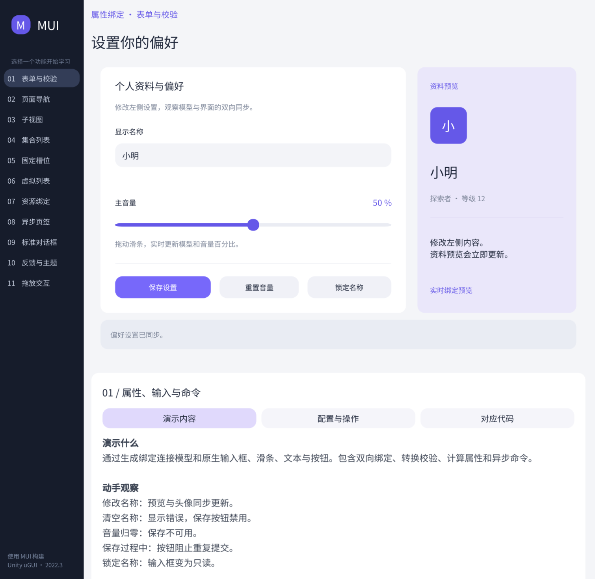

# MUI

面向 Unity 的页面、生成绑定、导航和虚拟列表框架。目标环境为 **Unity 2022.3.62f3**；uGUI、TMP 与 Input System 通过独立适配程序集按需接入。

核心采用统一异步生命周期；导航、生成绑定、列表、资源与可选输入适配的部分路径已有 Unity Play Mode 和 IL2CPP 运行记录。完整异常矩阵、示例交互和性能验收仍在进行，请以[实现记录](docs/IMPLEMENTATION-STATUS.md)核对具体覆盖范围。

## 安装与首次运行

1. 在目标 Unity 工程中打开 **Window → Package Manager**。
2. 点击 **+ → Add package from disk…**，选择本仓库根目录的 `package.json`。
3. 运行 uGUI 示例前，确认项目已安装 **Unity UI（com.unity.ugui）**；MUI 本身不再强制安装该后端。然后在 MUI 的 **Samples** 中导入 **MUI Examples**，一次导入全部教学示例，保留 Unity 标准目录 `Assets/Samples/MUI/<包版本>/MUI Examples`。
4. 打开 **Tools → MUI → 示例**，或 `Scenes/MUIExamples.unity`。进入 Play，在侧栏切换 11 项课程。

每项课程都有实际 Prefab 和独立 ViewModel，界面在编辑器中制作和配置。界面默认中文，右侧教学面板说明演示内容、配置操作和对应源码，并提供文件定位按钮；附带开源中文字体，无需额外包。运行时代码演示框架的加载、生成绑定、导航和生命周期；旧的程序化界面与自动巡检代码保留在 `Tools~/Diagnostics/Samples`，不再导入教学工程。更新旧版示例前先备份个人修改，再替换导入目录，避免遗留脚本冲突。

## 开发入口

普通页面由 ViewModel、登记原生组件引用的 View/Prefab、PageDefinition 和宿主配置组成，Presenter 按需使用。属性、命令与绑定接线由包内生成器生成。业务命令可直接声明在 partial Presenter 上，由宿主自动接入当前绑定会话，无需 ViewModel 转发 Handler。

- [入门与生命周期](Documentation~/index.md)
- [虚拟列表接入](Documentation~/virtual-lists.md)

- [示例学习路线与通用设置](Samples~/README.md)
- [表单页面的正常接入](Samples~/Scripts/Settings/README.md)
- [完整设计目标](docs/DESIGN-GOALS.md)
- [实现与验证状态](docs/IMPLEMENTATION-STATUS.md)
- [变更记录](CHANGELOG.md)

资源加载后端、业务数据仓库、分页与选择规则由项目提供。Provider 使用统一异步获取契约，本地资源可立即完成；不要在 Unity 主线程阻塞等待任务。

采用 [MIT License](LICENSE.md)。

## 依赖边界

Core、Pages、Widgets、Resources 和 Modules 不引用 Unity、uGUI 或 TMP。`Runtime/Unity` 是只依赖 UnityEngine 的通用组件绑定接入，生成器直接访问组件属性和事件。`Runtime/Integrations` 仅保留具体后端能力，例如 Canvas 宿主、焦点、滚动列表和可选 TMP 材质扩展。

基础控件不再提供 Image/Text/Button/Slider 等 Element 包装组件。在 View 中登记原生引用，使用 `nameof(UnityEngine.UI.Image.fillAmount)` 等原生成员。异步图片用 `ImageResources.SpriteSource` 属性扩展；扩展是按需创建的 C# 对象，无需挂载组件。旧项目需要移除基础控件包装并登记原生引用；包内当前示例和诊断示例已迁移。
